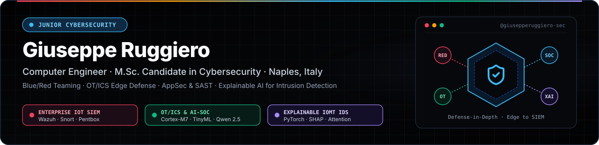

  

  <a href="https://giusepperuggiero-sec.github.io"><strong>Portfolio Web</strong></a>
  &nbsp;&middot;&nbsp;
  <a href="https://www.linkedin.com/in/giuseppe-ruggiero-558259320"><strong>LinkedIn</strong></a>
  &nbsp;&middot;&nbsp;
  <a href="mailto:pepperuggiero28@gmail.com"><strong>Email</strong></a>

---

### About Me

Computer Engineer (**B.Sc.** completed) and **M.Sc. Candidate in Cybersecurity** at the **University of Naples Federico II (DIETI)** with all specialization coursework completed (*Network Security*, *Software Security*, *Data Analysis and Cybersecurity*).

- **Industry & Practice:** Hands-on experience in IT user support, workstation setup, backup procedures, e-commerce database quality/integrity (**Argon ERP**, **Excel**), and **Python** workflow automation (*MondialTecnica*), plus multi-year private STEM & humanities tutoring.
- **Security Engineering Focus:** End-to-end Red & Blue Teaming (**Wazuh**, **Snort**, **Pentbox**), OT/ICS edge security (**Cortex-M7**, **TinyML**, **STRIDE**, **SAST**, **MITRE ATT&CK ICS**), application/binary analysis (**CodeQL**, **AFL**, **GDB/pwndbg**, **IDA**, **YARA**, **Sigma**), and Explainable AI for privacy-preserving intrusion detection.
- **Target Roles:** **Junior Cybersecurity** (SOC Analyst, Security Analyst, Junior Security Engineer) and **entry-level IT / Software Engineering**.

---

### Flagship Projects

| Repository | Domain | Architecture & Verified Highlights | Links |
| :--- | :--- | :--- | :--- |
| **[enterprise-iot-red-blue-siem](https://github.com/giusepperuggiero-sec/enterprise-iot-red-blue-siem)** | Network Security | Simulated SME kill chain (`Kali`, `Tomcat 8.0.43`, privileged `Docker` escape, `ED25519` persistence, `ARP spoofing`) detected by `iptables`, `Snort` NIDS, `Pentbox` honeypot (MAC spoofed), `Portenta H7` UDP syslog HIDS, and `5` custom `Wazuh SIEM` rules. | [Code](https://github.com/giusepperuggiero-sec/enterprise-iot-red-blue-siem) &middot; [Case Study](https://giusepperuggiero-sec.github.io/#enterprise-iot) |
| **[ot-ics-tinyml-ai-soc](https://github.com/giusepperuggiero-sec/ot-ics-tinyml-ai-soc)** | Software Security | 4-shield OT/ICS gateway on **Arduino Portenta H7** (`MQTT` anti-DoS rate limit, sanitization, physics bounds, Edge Impulse `TinyML`), **STRIDE** & **SAST** audited (`0` C++ issues via Flawfinder/Cppcheck), feeding a local **Ollama (`Qwen 2.5`)** SOC bound to **MITRE ATT&CK ICS (v19)** with prompt-injection defenses. | [Code](https://github.com/giusepperuggiero-sec/ot-ics-tinyml-ai-soc) &middot; [Case Study](https://giusepperuggiero-sec.github.io/#ot-ics-tinyml) |
| **[iomt-xai-intrusion-detection](https://github.com/giusepperuggiero-sec/iomt-xai-intrusion-detection)** | Data Analysis & Cybersecurity | Early privacy-preserving IoMT biflow classification (`CICIoMT2024`, `13` classes, `181,366` test flows, `T=10` packets / `6` header fields). Benchmarked `Lopez17CNN` (`84.76%` Macro-F1, `1.03 ms` CPU) vs. `MedDefenderTransformer` (`353K` params, `55%` lighter) with formal **GradientSHAP** vs. **Attention** causal audit (`MoRF/LeRF`) and `10/10` unit tests. | [Code](https://github.com/giusepperuggiero-sec/iomt-xai-intrusion-detection) &middot; [Case Study](https://giusepperuggiero-sec.github.io/#iomt-xai) |

---

### Technical Toolbox

| Area | Tools & Technologies |
| :--- | :--- |
| **Blue Team, SIEM & Hunting** | `Wazuh (SIEM / HIDS / FIM)` &middot; `Snort (NIDS)` &middot; `Sysmon` &middot; `Sigma` &middot; `Zircolite` &middot; `YARA / yarGen` &middot; `MITRE ATT&CK (Enterprise & ICS, Navigator)` &middot; `Pentbox` &middot; `Wireshark` &middot; `FakeNet` &middot; `VirusTotal` &middot; `STRIDE` |
| **AppSec, Offensive & Malware** | `CodeQL (SAST)` &middot; `AFL` &middot; `AddressSanitizer` &middot; `Valgrind` &middot; `Cppcheck` &middot; `Flawfinder` &middot; `Bandit` &middot; `GDB / pwndbg` &middot; `pwntools` &middot; `Nmap` &middot; `Metasploit / msfvenom` &middot; `John the Ripper` &middot; `IDA` &middot; `Capa` &middot; `PEiD` &middot; `Process Explorer / Monitor` &middot; `LOLBins` &middot; `OWASP Top 10` &middot; `PyRIT` |
| **Systems, Network & Embedded** | `Linux (Ubuntu, Kali)` &middot; `Windows (Event Viewer, Registry)` &middot; `iptables (NAT)` &middot; `Docker` &middot; `TCP/IP` &middot; `MQTT` &middot; `Arduino Portenta H7 (ARM Cortex-M7)` |
| **Languages & Scripting** | `Python` &middot; `C / C++ (Embedded)` &middot; `Java` &middot; `SQL` &middot; `Bash` &middot; `PowerShell` &middot; `Assembly` &middot; `VHDL` &middot; `SystemVerilog` |
| **AI, Data & Productivity** | `PyTorch` &middot; `Scikit-learn` &middot; `Pandas` &middot; `SHAP` &middot; `LIME` &middot; `Captum` &middot; `TinyML (Edge Impulse)` &middot; `Ollama` &middot; `Git` &middot; `LaTeX` &middot; `Argon ERP` |

---

### Education & Languages

- **M.Sc. in Computer Engineering (Cybersecurity Specialization)** — University of Naples Federico II *(In progress)*  
  *Specialization:* Network Security, Software Security, Data Analysis and Cybersecurity &middot; *AI & Cloud:* Machine Learning, Text Mining, Network and Cloud Infrastructures, AI Ethics
- **B.Sc. in Computer Engineering** — University of Naples Federico II *(Completed)*  
  *Relevant coursework:* Software Engineering, Databases, Operating Systems
- **Languages & Certifications:** Italian (*Native*) &middot; English **B2** (*Cambridge Certification, CLA Mezzocannone — University of Naples Federico II, 2025*)

